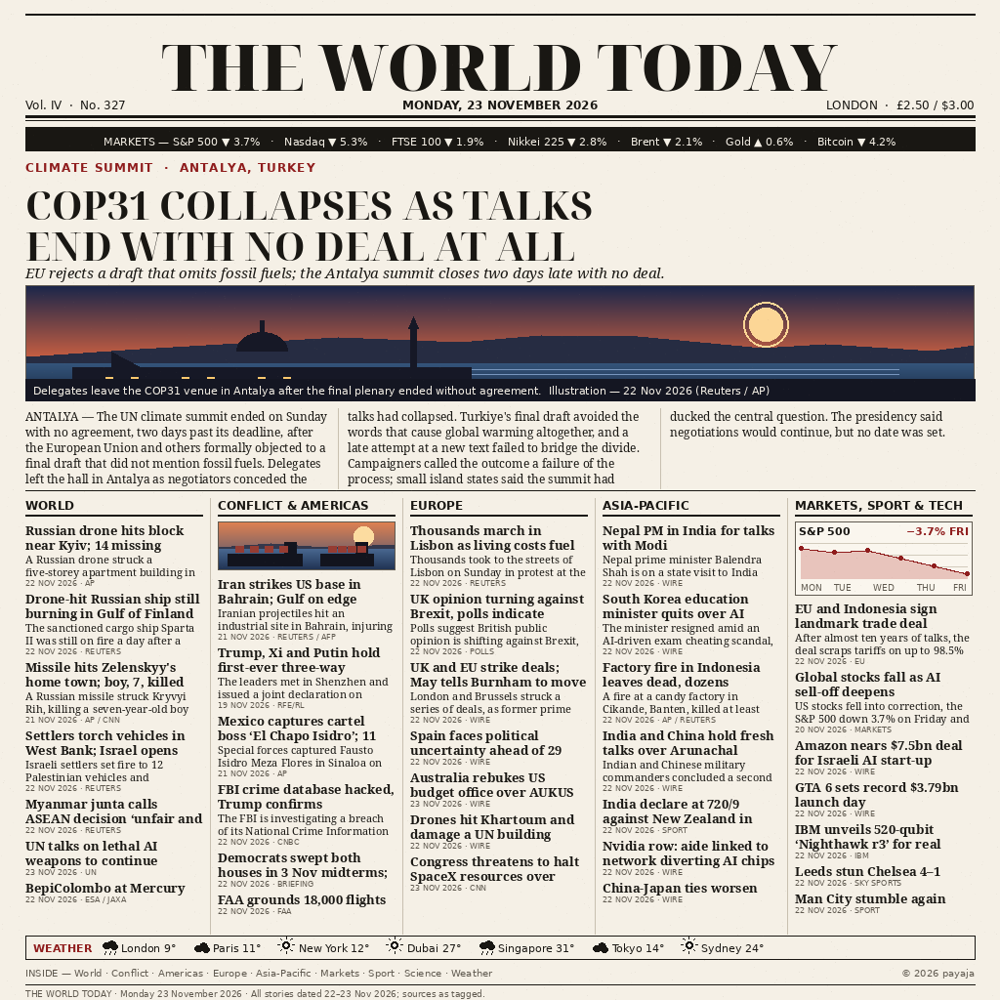

# THE WORLD TODAY — Monday 23 November 2026

[](https://make.fun/bounty/news-image-20261123)
[](https://make.fun/bounty/news-image-20261123)
[](https://make.fun/bounty/news-image-20261123)

One image summing up Monday 23 November 2026 world news — an entry for the
[make.fun news-image-20261123 bounty](https://make.fun/bounty/news-image-20261123).



## The page

A real printed-newspaper front page, drawn entirely in code — no external
images:

- **Masthead** with nameplate, date line, volume/issue and price; thin rule
  lines and a market ticker strip.
- **Hero story:** COP31 collapses in Antalya — big headline, standfirst, a
  programmatically drawn dusk scene (gradient sky, sun, mountains, sea,
  old-town skyline) and a three-column body.
- **Five-column news grid** — World, Conflict & Americas, Europe,
  Asia-Pacific, Markets / Sport / Tech — **35 dated stories** with a
  date/source tag on every one, plus a Strait of Hormuz scene, an S&P 500
  five-day line chart and a weather panel for seven cities.
- **Inside index** and colophon in the footer.

## Regenerate

```sh
python3 render.py   # writes entry.png (1024x1024, deterministic)
```

Requires Python 3 and Pillow (`pip install pillow`). Re-running produces a
byte-identical PNG.

`main.py` (standard library only) is the competition entry point: it copies
`entry.png` to the grader's output directory, mirroring the kit starter.

## Sources

Every story is dated 22–23 November 2026 and tagged with its source
(Reuters, AP, AFP, Al Jazeera, CNBC, wire summaries). Headline figures:
COP31 ending without a deal, Iran striking a US base in Bahrain, the
Trump–Xi–Putin trilateral summit in Shenzhen, the S&P 500 falling 3.7% and
the Nasdaq 5.3% on Friday 20 November. The market strip carries Friday's
close; the five-day chart path is illustrative.

## License

MIT — © 2026 payaja. See [LICENSE](LICENSE).
